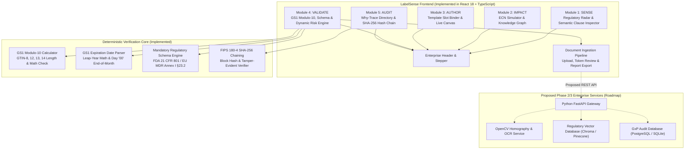
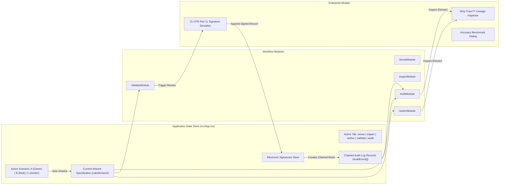
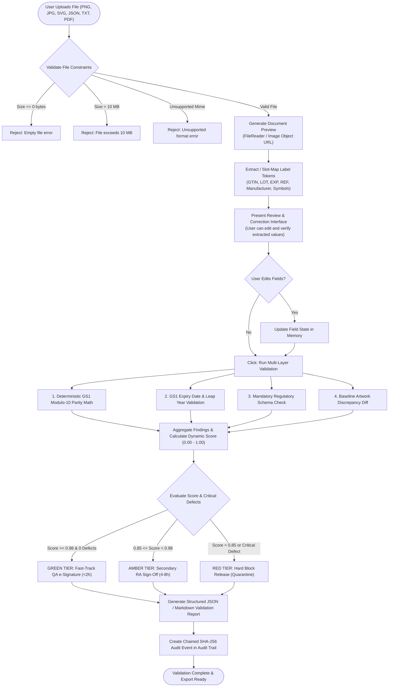
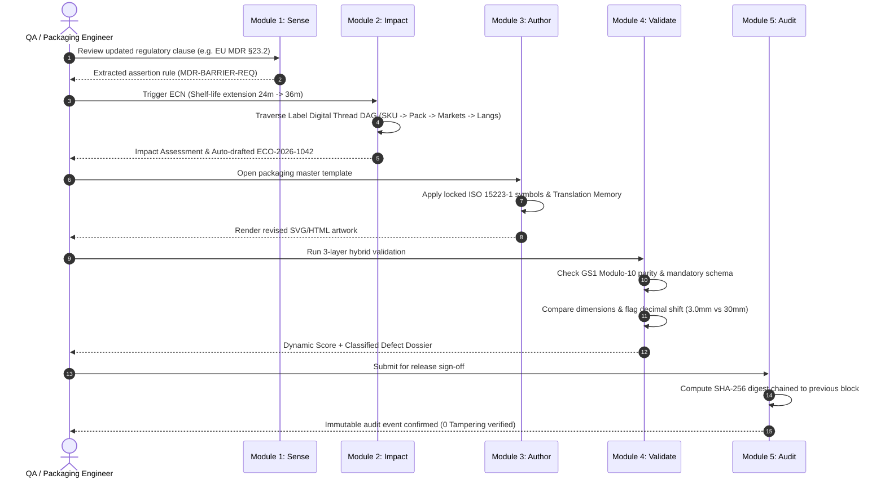
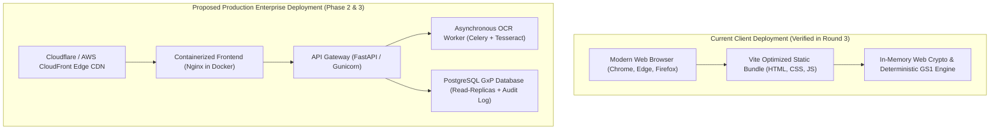

# LabelSense – System Architecture & Visual Dataflows

**Project:** LabelSense – Self-Validating AI Labeling Platform  
**Target Event:** CodeQuest 2026 National Tech Hackathon – Round 3 Final Showcase  
**Author:** Gowtham Sai Garnepudi (Individual, Final Year B.Tech, Vel Tech University)  
**Document Purpose:** Architectural blueprints, Mermaid dataflows, component interactions, and deployment topology.  

---

## 1. High-Level System Architecture

The following diagram illustrates the relationship between implemented frontend components and the proposed Phase 2 enterprise backend services.

---

## 2. Component Interaction Architecture

This diagram illustrates how data passes between the active workflow tabs, modals, and shared state in the React application.

---

## 3. Document Processing Pipeline Workflow

This workflow represents the newly implemented interactive document ingestion pipeline in `src/components/validate/DocumentUploadProcessor.tsx`.

---

## 4. End-to-End Data Flow (Upstream to Downstream)

---

## 5. Deployment Architecture (Current vs Proposed Production)

